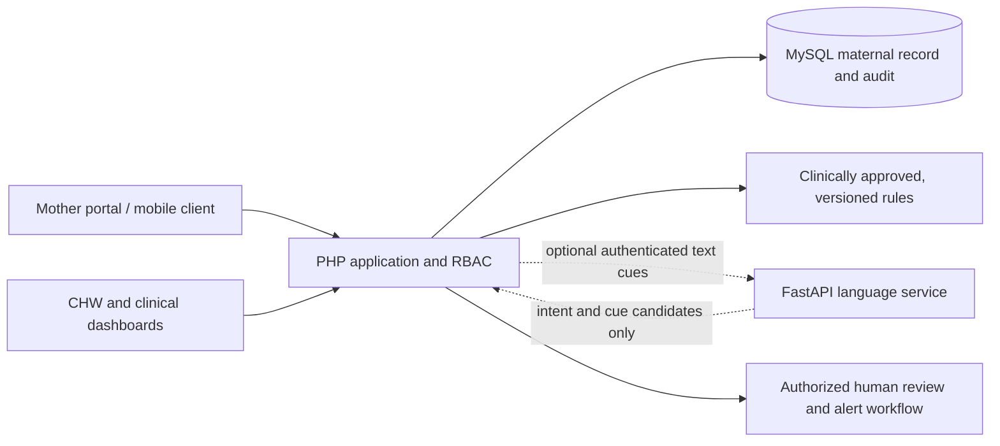

# M-CARE maternal intelligence foundation

## Responsibility boundary

PHP remains authoritative for login, role and catchment access, maternal records, validated clinical rules, alert assignment, referrals, final case state, and audit. The new FastAPI service is an optional language cue extractor; its output is advisory and cannot write to MySQL or route/close cases. The portal's existing approved-content helper remains the only automated education response path. No model is trained on private chats.



## Implemented in this increment

- Additive schema for versioned clinical rules, approved knowledge documents, model registry, privacy-minimized AI event metadata, professional feedback, and alert event history. New clinical rules default to draft and disabled.
- `maternal_intelligence.php` gives authorized staff a catchment-scoped view of open alerts with recorded pregnancy dates, latest ANC measurements, history flags, missing-data prompts, and a timestamped explanation/response event trail. It explicitly avoids diagnosis and recommended treatment.
- The existing PHP alert workflow now records created, assigned, notified, acknowledged, escalated, and closed events. Referral state and outcome changes are added to the audit log. Alert priority shows its current source: configured symptom-catalogue weights, which are routing metadata and not a diagnosis. Existing alert actions now include CSRF tokens.
- `ai_service/` provides an authenticated FastAPI baseline for English/Kinyarwanda intent and symptom cue extraction. It does not persist requests or make clinical decisions. Keyword extraction is a prototype and has not been validated.
- The existing woman-facing approved-content helper, structured symptom reporting, alert routing and separate portal pages remain in PHP.
- The maternal chatbot checks each submitted message against a limited English/Kinyarwanda urgent-warning phrase list before any optional NLP request. A match creates a critical alert and in-app notifications for active admins, the mother's assigned CHW, and facility staff; only the flagged message excerpt is stored, and the mother is told to seek care immediately. This is an unvalidated safety cue for human review, not a diagnosis, and the app does not continuously monitor chat or send SMS/email.
- After a symptom report is saved, `mother_report.php` immediately displays bilingual next-step guidance using selected warning-sign symptoms, self-reported severe/worsening status, and a general fallback. This is a fixed safety rule, not machine learning or a diagnosis; it does not wait for staff to read the report and it does not prescribe treatment.
- English/Kinyarwanda preference is now available from the shared header for every role and is stored on the user record; mother profiles are kept synchronized. The shared UI translation layer covers common navigation, page labels, forms, statuses and table controls. User-authored clinical notes, messages, and facility-published education are preserved as entered.

## Clinical review workflow

```mermaid
sequenceDiagram
  participant W as Woman
  participant P as PHP application
  participant N as Optional NLP service
  participant C as CHW / clinician
  participant D as MySQL
  W->>P: Symptom report or question
  P->>P: Authenticate, authorize, validate input
  P->>N: Optional minimum text for cue extraction
  N-->>P: Language, intent, cue candidates (advisory)
  P->>D: Save structured report, approved-rule result, audit metadata
  P->>C: Notify assigned responders using PHP workflow
  P-->>W: Approved emergency instructions when matched; never wait for NLP
  C->>P: Review, acknowledge, document outcome
```

## Remaining roadmap

1. Obtain clinical and Kinyarwanda review; configure versioned approved rules, emergency pathways, acknowledgement times and source documents. The current catalogue-weight routing behavior is a legacy MVP rule, not a clinically approved threshold. Until approval, do not activate new rules or use the classifier for triage.
2. Add governed structured ANC checks for hypertension/preeclampsia, infection screening, ANC completeness and nutrition follow-up, each with approved thresholds and human review.
3. Connect PHP to the private language service with short timeouts, request-size limits, service-token rotation, redaction, and safe fallback. Keep emergency guidance independent of that call.
4. Add professional feedback and alert acknowledgement history UI, escalation scheduler, delivery/retry tracking, and approved notification channels.
5. Build de-identified data governance and evaluation before any ML training. Split by patient, assess sensitivity/false negatives, calibration, language parity and bias, require independent clinical approval, then deploy versioned models with rollback.
6. Add longitudinal labour, delivery and postnatal records and mobile/voice interfaces after consent, retention, security and clinical workflows are defined. Voice transcription must be explicitly consented and reviewed for privacy and Kinyarwanda accuracy; it is not implemented yet.

## Deployment

Apply `migrations/005_maternal_intelligence_governance.sql` to the existing `care_db`, then deploy the FastAPI service privately with `MCARE_AI_SERVICE_TOKEN` supplied through a secret manager. Do not expose it directly to the public internet. The service currently uses a keyword baseline and should remain advisory until validated with de-identified, clinician-reviewed English and Kinyarwanda examples.
