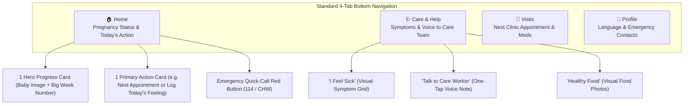
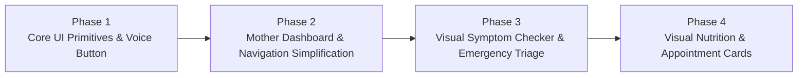

# M-CARE Low-Literacy & Inclusive UX Design Plan

This plan outlines the UX transformation of M-CARE to accommodate users with low literacy, limited smartphone experience, or language barriers, following international mHealth accessibility standards (WHO, UNICEF, and CommCare).

---

## 1. Core UX Philosophy: "See, Hear, Tap"

To remove frustration and cognitive load, the design transitions from **text-heavy reading** to **visual recognition and audio guidance**:

| Current Interface Pattern | Low-Literacy Interface Pattern |
| :--- | :--- |
| Paragraphs of medical advice & nutritional guidelines | Pictorial cards (photos/icons) + 1-sentence plain language |
| 7-question text symptom questionnaire | Large visual symptom cards + 1-tap urgency triage |
| Text inputs for messaging care team | Prominent "Hold to Talk" voice recording button |
| Fine toggles (e.g., Weeks vs Months, multi-level dropdowns) | Large, single-purpose cards with 56px+ tap targets |
| Reading-only content | Audio speaker button on every guidance card to read aloud in Kinyarwanda/English |

---

## 2. Standardized Layout & Navigation Architecture

We eliminate unconventional gestures, deep nested views, and horizontal micro-toggles, replacing them with standard, predictable navigation:

### Layout Rules:
1. **Full-Width Vertical Stacks**: No hidden horizontal scrolling or multi-column grids that require pinching or precision swiping.
2. **Generous Tap Targets**: All interactive elements are at least **56×56 points** with clear pressed states.
3. **High-Contrast Traffic-Light Palette**:
   - 🟢 **Green (`#2E7D32`)**: Safe, normal, healthy, completed.
   - 🟡 **Amber (`#ED6C02`)**: Attention needed, scheduled soon, mild discomfort.
   - 🔴 **Red (`#D32F2F`)**: Danger sign, urgent help, call clinician immediately.

---

## 3. Screen-by-Screen Transformation Plan

### A. Mother Dashboard (`src/app/mother/index.tsx`)
- **Visual Pregnancy Progress**:
  - Replace abstract sliders with a large hero illustration of baby growth at the current week.
  - Large display number: e.g. **"Week 21"** with simple milestone indicator: "Baby size of a mango 🥭".
- **Audio "Read Aloud" Button**:
  - A prominent speaker icon in the top header that speaks today's summary in the user's selected language (Kinyarwanda or English).
- **Two Big Action Cards**:
  1. 🩺 **"How do you feel today?"** (Tap to report feeling or symptoms).
  2. 📅 **"Next Doctor Visit"** (Shows calendar icon, clinic name, and day count with a countdown ring).
- **Persistent Emergency SOS Banner**:
  - Unmissable red emergency button at the bottom: **"Need Urgent Help? Call 114"** with a phone receiver icon.

### B. Simplified Symptom Reporting (`src/app/mother-symptoms.tsx`)
Currently, mothers must answer 7 required text questions (onset, pattern, severity, worsening, facility visit, CHW contact).
**New 2-Step Visual Flow:**
- **Step 1: Visual Symptom Tiles**
  - Large pictorial grid with high-contrast colored cards:
    - 🩸 **Heavy Bleeding** (Red border)
    - ⚡ **Severe Belly Pain** (Red border)
    - 🌡️ **High Fever / Chills** (Red border)
    - 👶 **Baby Not Moving** (Red border)
    - 🤕 **Severe Headache / Blurry Eyes** (Red border)
    - 🤢 **Vomiting / Weakness** (Amber border)
- **Step 2: Immediate Triage Outcome**
  - If any **Red** symptom is tapped:
    - Instantly show a full-screen alert card: **"Danger Sign Detected"** with a giant green **"Call Health Worker Now"** button and **"Call Ambulance 114"**.
  - If non-critical:
    - Offer a large **"Record Voice Message"** microphone button so the mother can speak in her own words instead of typing.

### C. Voice-First Care & Follow-Up (`src/app/mother/care.tsx`)
- Promote the **Voice Recorder** to the primary input:
  - Big circular microphone button: **"Hold to Speak"** or **"Tap to Record"**.
  - Visual waveform and playback button before sending.
  - One-tap send directly to the assigned Community Health Worker.

### D. Visual Nutrition Guidance (`src/app/mother/nutrition.tsx`)
- Eliminate lengthy paragraphs of clinical dietary advice.
- Replace with **"The Healthy Mother's Plate"**:
  - Photographic cards of accessible local Rwandan/East African foods:
    - 🥬 **Greens & Vegetables** (Dodo / Amaranth, Spinach, Carrots)
    - 🥚 **Proteins** (Eggs, Beans, Milk, Fish)
    - 🍠 **Energy Staples** (Sweet potatoes, Maize, Plantains/Igitoki)
    - 💧 **Clean Water** (Drinking 6-8 cups daily)
- Each food card has an audio speaker button to listen to guidance in Kinyarwanda.

### E. Calendar & Medication Reminders (`src/app/mother/reminders.tsx`)
- Use visual appointment tickets:
  - Big visual calendar block with day of the week and clinic name.
  - Pill bottle illustration with simple sun/moon icons for morning and evening vitamins/iron supplements (☀️ Morning / 🌙 Evening).

---

## 4. Reusable Inclusive UI Components to Create

We will add a dedicated suite of low-literacy components in `src/components/mcare-ui.tsx`:

1. **`AudioReadButton`**:
   - Compact circular speaker button that uses audio/speech to read any label or card in Kinyarwanda or English.
2. **`VisualActionCard`**:
   - Large card (min height 90px) featuring a high-contrast pictorial icon on the left, clear 2-word title, optional status color bar, and optional audio button.
3. **`PictorialSymptomTile`**:
   - 2-state visual tile with bold icon, clear border color (green/amber/red), and vibration haptic feedback on selection.
4. **`VoiceNoteRecorderButton`**:
   - Large touch-and-hold microphone button with elapsed time and clear visual recording state (pulsing ring).

---

## 5. Phased Execution Roadmap

1. **Phase 1: Inclusive UI Foundation**
   - Create `AudioReadButton`, `VisualActionCard`, and `PictorialSymptomTile` in `mcare-ui.tsx`.
   - Ensure all touch targets meet or exceed 56px.
2. **Phase 2: Mother Dashboard (`/mother`)**
   - Reorganize dashboard into the 3 visual zones: Pregnancy Milestone Hero, Today's Top Task, Emergency SOS.
3. **Phase 3: Visual Symptom & Voice Reporting (`/mother-symptoms` & `/mother/care`)**
   - Replace the 7-question text form with the visual danger-sign grid and voice note recorder.
4. **Phase 4: Visual Food & Reminders (`/mother/nutrition` & `/mother/reminders`)**
   - Implement local food photo cards and Sun/Moon medication reminders.
