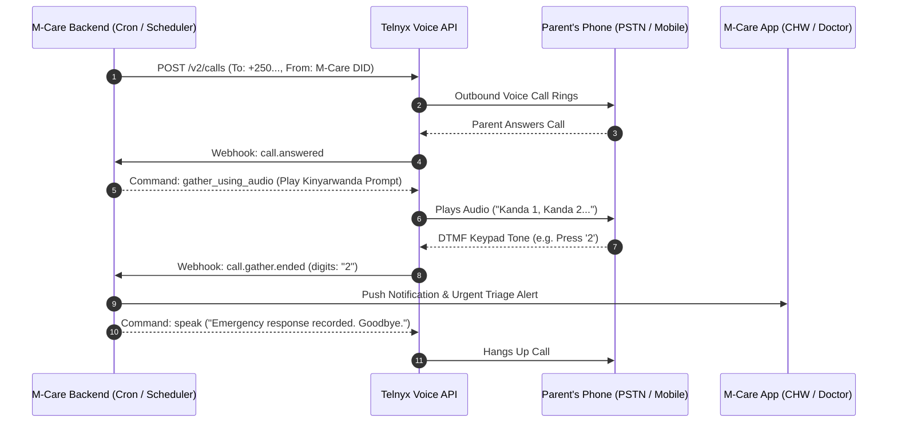

# Feasibility & Strategic Alignment: Telnyx IVR Automated Calls for M-CARE

## Executive Summary

| Dimension | Assessment | Notes |
| :--- | :--- | :--- |
| **Technical Feasibility** | **High (9.5/10)** | Telnyx Programmable Voice & Call Control API handles outbound calls, DTMF keypad capture, and webhooks with established Node.js SDKs. |
| **Strategic Alignment** | **Exceptional (10/10)** | Solves the primary point of failure in digital health: **parents not opening apps, lack of mobile internet, and low smartphone literacy**. |
| **Target User Reach** | **100% of phone owners** | Works on basic $10 2G keypad feature phones (Nokia/itel) as well as smartphones. No internet connection or app download needed for parents. |
| **Cost Effectiveness** | **Very High** | Automated 30-45 second check-in calls cost cents, drastically reducing manual CHW travel time for routine triage. |

---

## 1. The Core Problem It Solves

In maternal and child healthcare in Rwanda and sub-Saharan Africa, mobile apps face four critical barriers:
1. **Low App Retention / Fatigue:** Parents rarely open health apps regularly when feeling well, and wait too long when symptoms worsen.
2. **Device Disparity:** Many rural mothers own basic button/feature phones (no touchscreen, no apps, no data bundle).
3. **Connectivity Gaps:** Intermittent 3G/4G or lack of prepaid airtime prevents apps from syncing.
4. **Literacy:** Reading complex app screens requires effort; answering a phone call and pressing a keypad button is universal.

**IVR (Interactive Voice Response) flips the paradigm:**
Instead of expecting the mother to remember to open an app, **the system proactively calls her** based on her gestational week, clinical risk level, or upcoming clinic appointments.

---

## 2. How the IVR Flow Works for Parents

### Scenario: Automated Routine Week 21 Check-In

1. **Trigger:** The M-Care backend identifies that mother Aline (Week 21) is due for her bi-weekly check-in.
2. **Outbound Call:** At 10:00 AM, the system calls Aline's phone (+250 788...).
3. **Pickup & Kinyarwanda Greeting:**
   > *"Muraho Aline! Uyu ni umujyanama wawe w'ubuzima muri M-Care ukwifuriza kumererwa neza mu cyumweru cya 21 cy'inda yawe.*
   > 
   > - *Kanda **1** niba umeze neza nta kibazo ufite.*
   > - *Kanda **2** niba ufite uburibwe, umuriro, cyangwa amaraso.*
   > - *Kanda **3** niba wifuza kuvugana na Marie Claire (umujyanama wawe)."*
4. **User Action:** Aline presses **1**, **2**, or **3** on her phone dial pad.
5. **Backend Processing:**
   * **Key 1 (Well):** Logged into M-Care database as *"Routine Check-in: Healthy"*.
   * **Key 2 (Danger Sign):** Telnyx speaks an emergency prompt (*"Hagarara gato, tugiye kumenyesha umujyanama wawe byihuse"*), and immediately creates a **Critical Red Alert** on the CHW & Doctor app feeds.
   * **Key 3 (Connect):** Telnyx executes a `transfer` command to bridge Aline's call directly to CHW Marie Claire's mobile number.

---

## 3. Architecture & Data Flow

---

## 4. Key Engineering & Strategic Considerations

### A. Pre-Recorded Kinyarwanda vs. Text-to-Speech (TTS)
* **Text-to-Speech (TTS):** Standard cloud TTS engines (AWS Polly, Google TTS) often sound robotic or struggle with nuanced Kinyarwanda grammar and village dialect pronunciation.
* **Recommended Approach (`gather_using_audio`):** Pre-record human audio clips with a native Kinyarwanda nurse or health worker and host them on an S3/CDN bucket (e.g. `prompts/week21-intro.mp3`, `prompts/menu-options.mp3`). This sounds warm, comforting, and authentic to rural parents.

### B. Where Telnyx Lives
* **Backend Only:** Telnyx API calls require an API key and webhook endpoints (`POST /webhooks/telnyx/voice`). This is hosted on your backend server (e.g. Node.js/Express, Supabase Edge Functions, or Python FastAPI).
* **The Expo App's Role:**
  * **Community Health Workers (CHWs):** Receive instant alerts from IVR inputs. CHWs can also tap a button in the app: *"Trigger Automated Check-in Call Now"* for mothers who missed appointments.
  * **Clinicians/Doctors:** View the full log of automated IVR check-ins in the patient's timeline alongside facility lab results.

### C. Telnyx vs. Regional Telecom Providers
While Telnyx is technically excellent, for production in East Africa you should also consider **Africa's Talking**:
* **Telnyx:** Global infrastructure, SIP trunking, robust Call Control API, pay-as-you-go pricing. Calls to Rwanda numbers run via international VoIP routes (~$0.15 - $0.25/min).
* **Africa's Talking:** Directly integrated with telecom carriers in Rwanda (MTN Rwanda & Airtel Rwanda), allowing local Rwandan phone numbers (e.g., +250 78... or short codes) as caller IDs and local per-minute billing.
* **Recommendation:** Telnyx is ideal for prototyping and global rollouts; the same webhook/IVR logic can easily swap to Africa's Talking for local carrier optimization in Rwanda.

---

## 5. Proposed 4-Phase Implementation Plan

### Phase 1: Prototype Backend & Webhook Server
1. Create a lightweight Node.js/TypeScript webhook service (using `telnyx` npm package).
2. Set up Telnyx Call Control application with inbound/outbound webhook URLs.
3. Implement `gather_using_audio` or `gather_using_speak` for a 3-choice menu (1: Well, 2: Sick, 3: Transfer to CHW).

### Phase 2: M-Care Data Model & Alert Integration
1. Extend `PatientRecord` schema in M-Care to include `lastIvrCallDate`, `ivrCallStatus`, and `ivrResponseHistory`.
2. Connect the webhook output to create an entry in the CHW's alert center when a mother presses `2` (Danger sign).

### Phase 3: CHW App Action Trigger
1. Add a *"Call Parent via IVR"* button in the CHW interface ([src/app/chw](file:///d:/PROJECTS/m-care/src/app/chw)) allowing health workers to initiate automated check-ins with one tap.
2. Display call outcomes (Answered, Unanswered, Key 1, Key 2) in the mother's record card.

### Phase 4: Automated Scheduling (Cron / Event-Driven)
1. Automatically trigger IVR calls 2 days prior to scheduled Antenatal Care (ANC) visits as an appointment reminder.
2. Trigger check-in calls 24 hours after a missed clinic visit.

---

## Conclusion
Adding an automated IVR call system is **fully feasible** and directly aligns with the mission of M-CARE. It bridges the digital divide, ensures low-literacy parents receive life-saving monitoring without needing to operate a smartphone app, and delivers high-value, actionable alerts directly into the hands of health workers and doctors.
